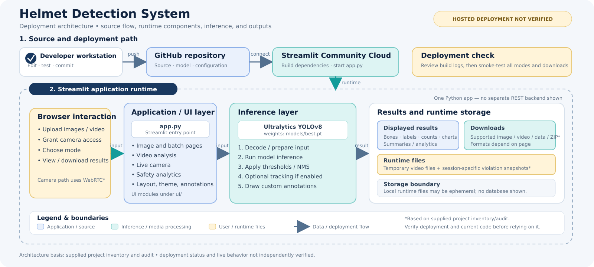

# Helmet Detection System — Deployment Architecture

> **Architecture brief | Revision: 19 October 2026**  
> **Status:** Intended hosting target is Streamlit Community Cloud. A successful public deployment and public URL have not been verified in the supplied context.

## Executive overview

The Helmet Detection System is a Python application intended to help analyse road-safety footage by identifying relevant objects and helmet-related violations. The application combines a Streamlit interface with a trained Ultralytics YOLOv8 model. The supplied project inventory reports modes for single images, batch images, video, live camera, and safety analytics, alongside annotated results and downloads.

This document is based on the project file inventory, dependency listing, and deployment audit supplied in the conversation. The local repository was not mounted for independent file-by-file inspection. Claims described as implementation details should therefore be checked against the exact commit used for deployment before being presented as independently audited facts.

### Main components and responsibilities

| Component | Responsibility | Notes |
|---|---|---|
| `app.py` | Streamlit entry point and app composition | Reported entry point; intended command is `streamlit run app.py`. |
| `ui/` | UI layout, styles, theme, pages, and annotation renderer | Includes image, batch, video, live-camera, and analytics modules in the supplied inventory. |
| `models/best.pt` | Trained weights loaded for inference | Reported size: approximately 6.23 MB (6,226,346 bytes). File size is not a measure of runtime RAM use. |
| `requirements.txt` | Python dependency installation | Supplied listing pins Streamlit, Ultralytics, headless OpenCV, Pillow, WebRTC, PyAV, NumPy, Pandas, Altair, and a `lap` lower bound. Re-check compatibility at build time. |
| `.streamlit/config.toml` | Streamlit application configuration | The supplied inventory shows this file; no secrets should be committed. |
| `sample_media/` | Demonstration inputs | Supplied inventory includes a sample image and a sample traffic video. |
| `tests/` | Automated and UI test code | The command shown in the conversation ran `tests/test_pipeline.py`: 6 tests passed. The UI test file was not shown as executed. |

## Processing pipelines

### Single image

`Image upload → decode / prepare → YOLOv8 inference → detection filtering / NMS → annotation → metrics and result display → download`

The upload is decoded into an image representation, passed to the model, and displayed with annotated detections. Confidence thresholds and IoU/NMS affect which predictions remain. The exact preprocessing and output formats should be verified in the deployed commit.

### Batch images

`Multiple images → per-image inference → per-image annotated results → aggregate summary → downloadable output`

Batch processing reuses the image detection path across multiple files and aggregates results. The supplied project inventory reports ZIP export and a batch summary CSV; verify the exact ZIP contents in a live smoke test.

### Video

`Video upload → temporary file → video decode → frame selection / stride → inference → optional tracking → frame annotation → results / export → cleanup`

Frame stride trades temporal detail for processing time: analysing fewer frames can reduce runtime but can miss brief events. Confidence threshold filters weak detections; IoU/NMS suppresses overlapping predictions. The supplied audit reports temporary-video cleanup and session-specific violation folders. The exact cleanup behavior should be smoke-tested on the hosted runtime.

### Live camera

`Browser camera permission → media capture → WebRTC → Streamlit WebRTC component → decoded frames (PyAV) → inference → annotated frames → browser display`

`streamlit-webrtc` is used for real-time media integration and PyAV (`av`) handles media frame representations when wired by the application. The supplied audit reports Google STUN configuration (`stun:stun.l.google.com:19302`). STUN can help peers establish connectivity, but restrictive firewalls, NAT types, or network policy can still prevent a connection; a TURN relay is not shown in the supplied project inventory.

## Technology decisions

| Technology / technique | Project role | Why it fits | Trade-off / limitation |
|---|---|---|---|
| Python + Streamlit | Application runtime and UI | Keeps UI and inference in one Python-oriented app and avoids maintaining a separate frontend/backend stack. | Less fine-grained browser control than a custom frontend; reruns and server resource usage need care. |
| Ultralytics YOLOv8 + `models/best.pt` | Object detection | Provides trained detection inference for the project's helmet-related classes. | Quality and speed depend on trained weights, input size, thresholds, and CPU/RAM availability. |
| OpenCV Headless + Pillow + NumPy | Image/video decoding and array manipulation | Suitable for server-side processing without desktop GUI requirements. | Native dependencies and decoded frames still consume resources; headless packaging alone does not guarantee build compatibility. |
| `streamlit-webrtc` + PyAV (`av`) + STUN | Browser live-camera transport and frame handling | Supports real-time frame flow into Python processing. | Browser permissions and network/firewall conditions can make connectivity unreliable on some networks. |
| ByteTrack + `lap` (where active in the deployed path) | Associate detections across frames | Can help maintain object identity over time instead of treating every frame independently. | Adds computation and association complexity; confirm the actual tracker settings in code. |
| Pandas + Altair | Tabular summaries and visual analytics | Useful for aggregating detection/violation data and rendering charts inside Streamlit. | Chart meaning is limited by the quality and scope of the underlying session data. |
| Git + GitHub | Versioned source and repository hand-off | Makes the source and required assets available to a repository-connected deployment service. | GitHub stores source; it does not execute inference. Model assets must be included or otherwise made available. |
| requirements.txt, `packages.txt`, `.streamlit/config.toml` | Runtime setup | Makes Python/system packages and Streamlit defaults reproducible across machines. | Pinned versions can conflict with platform wheels or Python versions; build logs must be checked. |
| Streamlit Community Cloud (target) | Intended managed host | Offers a straightforward deployment path for a Streamlit app connected to a repository. | CPU/RAM, cold start, runtime storage, concurrency, and media processing limits must be validated on the actual deployment. |
| Python test files | Regression coverage | Provides repeatable checks for pipeline behavior. | The conversation showed 6 passing pipeline tests only; UI tests and hosted behavior remain unverified. |

## Deployment lifecycle

1. Develop and smoke-test locally.
2. Commit intended files to Git.
3. Push the project to the selected GitHub repository, including `app.py`, `ui/`, requirements.txt, `packages.txt` if required, `.streamlit/config.toml`, `models/best.pt`, and required media/assets.
4. In Streamlit Community Cloud, select the repository, branch, and main file path `app.py`.
5. The platform installs dependencies and starts Streamlit. Review build/runtime logs for dependency, import, model-path, and resource errors.
6. Open the public app, test each mode, and verify camera connectivity and downloads.

**Status boundary:** The deployment flow above is the intended topology, not proof that each hosted step has succeeded. The repository push and live deployment status were not established by the material available for this document.

## Data lifecycle, storage, and privacy

`User input → app runtime → model inference → annotated output / metrics → browser display or download → temporary-file cleanup where implemented`

- **Repository assets:** model weights, source, config, and demo inputs are repository/deployment assets; they are distinct from visitor uploads.
- **Uploaded files and video frames:** normally enter the application process for analysis. The exact retention and handling depend on code paths.
- **Temporary video files:** the supplied audit reports tracking temporary paths in session state and deleting prior uploads / cleaning after analysis. Validate this on the deployed app, including errors and browser disconnects.
- **Violation snapshots:** the supplied audit reports per-session folders such as `violations/<session_id>/`. This can reduce accidental cross-session visibility, but session IDs and directories are not a complete security boundary.
- **Hosted filesystem:** treat local runtime storage as potentially ephemeral. Do not assume it is durable, private across every failure mode, or shared across future instances.
- **Camera frames:** pass through the browser/WebRTC path and server-side processing as configured; confirm network behavior and privacy notices before inviting public use.
- **Secrets:** keep `.env`, `.streamlit/secrets.toml`, access tokens, and credentials out of Git. The example secrets file is not a substitute for secure runtime secret management.
- **Downloads:** visitors may receive generated output files. Do not upload sensitive footage to a public demo without reviewing retention, access controls, and privacy obligations.

## Operational checklist

- **Python/dependencies:** ensure the selected Python version has compatible wheels for every pinned dependency; review Streamlit build logs.
- **Model:** confirm `models/best.pt` is committed, readable, and loaded with a repository-relative path.
- **Resources:** video decoding and model inference require more memory than the 6.23 MB model file alone suggests. Test realistic inputs and keep processing expectations modest on a small shared host.
- **WebRTC:** test camera permission, HTTPS access, and a second network/device. STUN is not a guarantee for every network.
- **Storage:** verify temp cleanup for successful, failed, and abandoned analysis; don't rely on local hosted disk for durable storage.
- **Regression:** the demonstrated command `python tests/test_pipeline.py` passed 6 tests in the recorded session. Run UI tests separately where their browser dependencies are available.
- **Scope:** do not imply a database, REST service, Docker image, CI/CD workflow, external object storage, or separate frontend unless one is actually added and verified.

## STAR interview explanation (60–90 seconds)

**Situation:** Reviewing road footage to spot riders who may not be wearing helmets can be repetitive, especially when the input includes many images or long videos.

**Task:** Build a practical application that can accept images, batches, video, and live camera input and present useful detections and summaries in one interface.

**Action:** I built a Python application using Streamlit for the interface and an Ultralytics YOLOv8 model loaded from `models/best.pt` for detection. The application is organised into separate UI modules for image, batch, video, live camera, and analytics. OpenCV and related image/media libraries support decoding and frame processing; Streamlit-WebRTC and PyAV support the live stream path. The application can present annotations and supported exports, while Git and GitHub provide the source hand-off for the intended Streamlit Community Cloud deployment. I added test coverage and configuration to make local behavior and hosting setup easier to check.

**Result:** The supplied local test run showed 6 passing pipeline tests, and the repository inventory includes a trained model and demo media. Hosted deployment, real-world detection quality, resource use, and successful live-camera access must be validated separately before claiming production outcomes.

## Key trade-offs

- Streamlit reduces application-stack complexity but is not a substitute for a high-scale inference service.
- Video frame stride can improve throughput but may miss short events.
- Session-specific folders improve separation but do not by themselves provide strong multi-tenant security.
- Managed hosting simplifies operations but resource limits and ephemeral filesystems constrain long-running or storage-heavy workloads.
- Public deployment should follow a live smoke test covering all application modes, file cleanup, downloads, and privacy behavior.
